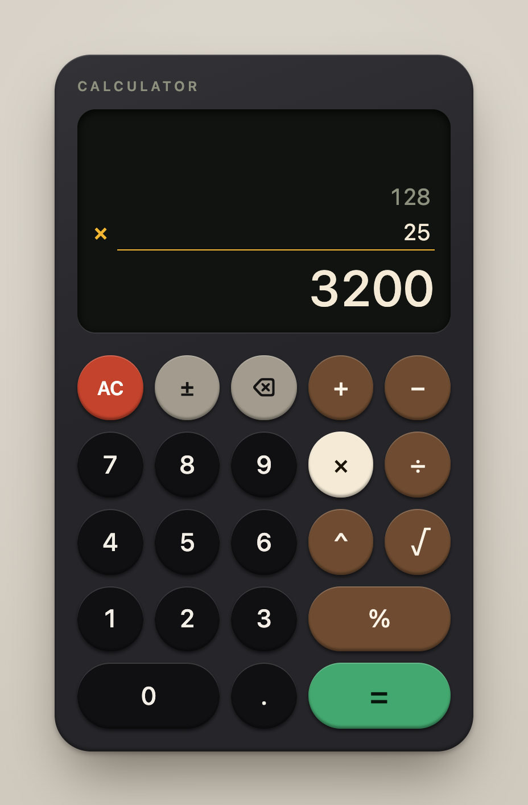

# Full-Stack Calculator

A calculator with a Go REST API and a React + TypeScript frontend. It supports addition, subtraction, multiplication, division, exponentiation, square root, and percentage.

All calculation happens on the backend. The frontend collects input, sends it to the API, and displays the result or error.



```
.
├── backend/
│   ├── cmd/server/          # Entry point: configuration, wiring, graceful shutdown
│   ├── internal/
│   │   ├── api/             # Routing, request decoding, error-to-status mapping
│   │   └── calculator/      # Pure maths and typed errors, with no HTTP code
│   └── Dockerfile           # Backend image
├── frontend/                # React + TypeScript app built with Vite
│   ├── Dockerfile           # Frontend image: nginx serving the built app
│   └── nginx.conf           # Serves the app and forwards API requests to the backend
├── docs/                    # Spec, tickets, and AI prompt log
├── docker-compose.yml       # Runs the backend and frontend together
├── Dockerfile               # Alternative: one image containing the API and frontend
├── Makefile                 # test, coverage, lint, build, and Docker commands
└── mise.toml                # Pinned Go and Node versions
```

## Prerequisites

| Tool | Version | Needed for |
|---|---|---|
| [Docker](https://docs.docker.com/get-docker/) with Compose v2 | Any recent version | Running the stack in containers. Nothing else is needed for this option. |
| [Go](https://go.dev/dl/) | 1.27 | Running and testing the backend locally |
| [Node.js](https://nodejs.org/) and npm | 26 | Running and testing the frontend locally |
| Make | Any | Optional shortcuts for the commands below |

If you use [mise](https://mise.jdx.dev), `mise install` installs the pinned Go and Node versions.

## Run with Docker Compose

```sh
docker compose up --build
```

| URL | What it serves |
|---|---|
| <http://localhost:3000> | The calculator. nginx serves the app and forwards `/api` and `/healthz` to the backend. |
| <http://localhost:8080> | The API directly, as used by the `curl` examples below |

To run it in the background and wait until it's healthy, use `docker compose up --build -d --wait`. To stop it, use `docker compose down`.

The frontend service's health check requests `/healthz` through nginx, so it fails if either service is down. The backend has no health check of its own because its distroless image has no shell or HTTP client to run one with.

## Run locally

Start the backend in one terminal:

```sh
cd backend
go run ./cmd/server
```

Start the frontend in another:

```sh
cd frontend
npm ci
npm run dev
```

Then open <http://localhost:5173>. Vite forwards `/api` requests to the backend on port 8080, so CORS isn't needed.

### Configuration

The server reads two environment variables:

| Variable | Default | Purpose |
|---|---|---|
| `PORT` | `8080` | Port the server listens on |
| `STATIC_DIR` | Unset | Directory of built frontend files to serve. When unset, the server runs API-only. |

### Common commands

| Command | What it does |
|---|---|
| `make test` | Runs the backend and frontend tests |
| `make coverage` | Runs both test suites and writes coverage reports |
| `make lint` | Runs `gofmt`, `go vet`, ESLint, and `tsc` |
| `make build` | Builds the backend and frontend |
| `make docker-up` | Builds and starts the stack with Docker Compose |
| `make docker-run` | Builds the single-image alternative and runs it on port 8080 |

## Tests and coverage

Run everything from the repository root:

```sh
make test       # Both test suites
make coverage   # Both test suites, with coverage reports
```

Or run each suite directly:

```sh
# Backend
cd backend
go test ./...
go test -coverprofile=coverage.out ./...
go tool cover -func=coverage.out                  # Per-function summary
go tool cover -html=coverage.out -o coverage.html # Line-by-line report

# Frontend
cd frontend
npm test
npm run coverage                                  # Summary, plus an HTML report
```

`make coverage` prints both summaries and writes these reports, which git ignores:

- `backend/coverage.html`
- `frontend/coverage/index.html`

Coverage when this was last updated:

| Module | Statements | What isn't covered |
|---|---|---|
| `internal/calculator` | 100% | Nothing |
| `internal/api` | 93.4% | The `internal_error` fallback and a failed response write, which the handler's interface gives tests no way to trigger |
| `cmd/server` | 0% | Configuration and shutdown wiring, which has no logic of its own and has no unit tests |
| Frontend `src/` | 97.1% | A response that is valid JSON in an unexpected shape, and one defensive branch. `main.tsx` is excluded. |

## API

All calculator routes use `POST`, and both requests and responses are JSON. The examples use port 8080, which is the backend in every way of running the project.

| Route | Body | Result |
|---|---|---|
| `/api/v1/add` | `{"a": 2, "b": 3}` | `a + b` |
| `/api/v1/subtract` | `{"a": 2, "b": 3}` | `a - b` |
| `/api/v1/multiply` | `{"a": 2, "b": 3}` | `a * b` |
| `/api/v1/divide` | `{"a": 6, "b": 3}` | `a / b` |
| `/api/v1/power` | `{"a": 2, "b": 3}` | `a` raised to the power of `b` |
| `/api/v1/percentage` | `{"a": 20, "b": 50}` | `a` percent of `b` |
| `/api/v1/sqrt` | `{"a": 9}` | Square root of `a` |

`GET /healthz` returns `200` with `{"status":"ok"}`.

### Successful requests

Every success returns `200` with `{"result": <number>}`.

```sh
curl -X POST http://localhost:8080/api/v1/add \
  -H 'Content-Type: application/json' \
  -d '{"a": 2, "b": 3}'
# {"result":5}

curl -X POST http://localhost:8080/api/v1/subtract \
  -H 'Content-Type: application/json' \
  -d '{"a": 2, "b": 3}'
# {"result":-1}

curl -X POST http://localhost:8080/api/v1/multiply \
  -H 'Content-Type: application/json' \
  -d '{"a": 2, "b": 3}'
# {"result":6}

curl -X POST http://localhost:8080/api/v1/divide \
  -H 'Content-Type: application/json' \
  -d '{"a": 6, "b": 3}'
# {"result":2}

curl -X POST http://localhost:8080/api/v1/power \
  -H 'Content-Type: application/json' \
  -d '{"a": 2, "b": 10}'
# {"result":1024}

curl -X POST http://localhost:8080/api/v1/percentage \
  -H 'Content-Type: application/json' \
  -d '{"a": 20, "b": 50}'
# {"result":10}

curl -X POST http://localhost:8080/api/v1/sqrt \
  -H 'Content-Type: application/json' \
  -d '{"a": 9}'
# {"result":3}

curl http://localhost:8080/healthz
# {"status":"ok"}
```

### Error responses

Errors have the shape `{"error": {"code": <string>, "message": <string>}}`. The `code` value is stable and meant for programs to check. The `message` value is for people to read and may change.

| Status | Code | When it's returned |
|---|---|---|
| 400 | `invalid_request` | Malformed JSON, missing fields, wrong types, unknown fields (including `b` on `sqrt`), or numbers too large for `float64`, such as `1e999` |
| 413 | `request_too_large` | The request body is larger than 1 KB |
| 422 | `division_by_zero` | Dividing by zero, or raising zero to a negative power, such as `0^-1` |
| 422 | `undefined_result` | The result isn't a real number, such as the square root of a negative number or `(-8)^0.5` |
| 422 | `result_out_of_range` | The result is too large for `float64`, such as `10^10000` |

A `500` with code `internal_error` is reserved for unexpected server faults and shouldn't occur in normal use.

Add `-i` to any of these commands to see the status code.

```sh
# 400: malformed JSON
curl -X POST http://localhost:8080/api/v1/add \
  -H 'Content-Type: application/json' \
  -d '{"a": 2,'
# {"error":{"code":"invalid_request","message":"the request body must be a JSON object containing only the numeric fields: a, b"}}

# 400: missing field, which never silently becomes 0
curl -X POST http://localhost:8080/api/v1/add \
  -H 'Content-Type: application/json' \
  -d '{"a": 2}'
# {"error":{"code":"invalid_request","message":"the request body must be a JSON object containing only the numeric fields: a, b"}}

# 400: wrong type
curl -X POST http://localhost:8080/api/v1/add \
  -H 'Content-Type: application/json' \
  -d '{"a": "2", "b": 3}'
# {"error":{"code":"invalid_request","message":"the request body must be a JSON object containing only the numeric fields: a, b"}}

# 400: unknown field
curl -X POST http://localhost:8080/api/v1/sqrt \
  -H 'Content-Type: application/json' \
  -d '{"a": 9, "b": 3}'
# {"error":{"code":"invalid_request","message":"the request body must be a JSON object containing only the numeric fields: a"}}

# 413: body larger than 1 KB
head -c 2048 /dev/zero | tr '\0' ' ' | curl -X POST http://localhost:8080/api/v1/add \
  -H 'Content-Type: application/json' \
  --data-binary @-
# {"error":{"code":"request_too_large","message":"the request body is too large"}}

# 422: division by zero
curl -X POST http://localhost:8080/api/v1/divide \
  -H 'Content-Type: application/json' \
  -d '{"a": 1, "b": 0}'
# {"error":{"code":"division_by_zero","message":"cannot divide by zero"}}

# 422: no real result
curl -X POST http://localhost:8080/api/v1/sqrt \
  -H 'Content-Type: application/json' \
  -d '{"a": -1}'
# {"error":{"code":"undefined_result","message":"the result is not a real number"}}

# 422: result too large
curl -X POST http://localhost:8080/api/v1/multiply \
  -H 'Content-Type: application/json' \
  -d '{"a": 1e308, "b": 10}'
# {"error":{"code":"result_out_of_range","message":"the result is too large to represent"}}
```

Unknown routes and wrong methods are the exception to this format: they return Go's default plain-text `404` and `405` responses.

```sh
# 404: unknown route
curl -X POST http://localhost:8080/api/v1/unknown
# 404 page not found

# 405: wrong method
curl http://localhost:8080/api/v1/add
# Method Not Allowed
```

### Edge cases

- `0^0` returns `1`, matching Go's `math.Pow`.
- A result of `-0` is returned as `0`.
- If a request repeats a field, such as `{"a":1,"a":2,"b":3}`, the last value is used.
- `percentage` can return `result_out_of_range` for a result within rounding error of the largest `float64`, even when the exact answer fits.

## Key design decisions

### A keypad over a single-operation form

The UI looks like a pocket calculator, but underneath it's still a form with two text inputs and a radio group of operations. The keypad only edits those inputs, so you can also type into them directly. Each `=` makes one API call and shows one result, which handles one-input and two-input operations cleanly and makes per-field validation natural. Pressing an operation after a result continues from that result, and a digit starts a new calculation. There's no expression parsing or operator precedence, because the client never does the maths.

### One route per operation

Each operation's required fields are clear from its route, and the routes map directly to the required operations. They all come from one table of operations, with shared adapters for one-operand and two-operand calculations, so adding a route takes little code.

### `float64` instead of a decimal library

A decimal library would make `0.1 + 0.2` exact, but square roots and fractional exponents still can't be exact, so the API would end up with mixed precision rules. `float64` needs no dependencies and behaves consistently.

The trade-off is standard floating-point behaviour: the API returns `0.30000000000000004` for `0.1 + 0.2`. The UI rounds results to 12 significant digits for display. This approach isn't suitable for financial calculations that need exact decimal results.

### Separate 400 and 422 errors

A 400 means the request itself is wrong and the client needs to fix it. A 422 means the request is well formed, but the maths has no representable answer. Non-finite results have to be errors because JSON can't represent `Inf` or `NaN`.

Request fields must match exactly, so a missing `b` returns an error instead of silently becoming `0`, and `{"A": 2}` isn't accepted as `a`. The server reads the whole body before parsing it, so the size limit applies however the body is malformed.

### Maths rules live only on the server

The client checks that inputs are present, are well-formed numbers, and fit in a double, since `JSON.stringify` would turn `1e999` into `null`. Rules such as "can't divide by zero" live only in the backend, so there's a single source of truth. The UI maps stable error codes to the relevant field, which gives inline errors without parsing message text.

Inputs use `type="text"` because `type="number"` reports an empty value for partial input, and some iOS decimal keyboards have no minus key.

### Pure calculator package

`internal/calculator` knows nothing about HTTP, so the maths can be tested directly with table-driven tests. `internal/api` is tested separately through `httptest`.

### Separate containers behind one origin

Docker Compose runs the backend and frontend as separate images, so each can be built, replaced, and restarted on its own. Both are multi-stage builds, so the final images contain no compilers, `node_modules`, or source code, and both run as non-root users. The backend image is distroless.

nginx forwards `/api` to the backend, so the browser only ever talks to one origin and neither Compose nor local development needs CORS configuration. It also means the app calls the same relative URLs under Vite, nginx, and the single image.

### A single-image alternative

The root `Dockerfile` builds one image in which the Go server also serves the frontend from `STATIC_DIR`, for deployments that want one process and one port with no nginx. `make docker-run` builds and runs it.

The server reads frontend files from a directory rather than using `go:embed`. That way, `go build` and `go test` don't depend on a built frontend. The app has no client-side routes, so a plain file server is enough.

### Minimal dependencies

The backend uses only the Go standard library, including `net/http` method-and-path routing. The frontend uses plain CSS and `useState`, because a single form doesn't need a UI or state management library.

### Testing scope

- **Backend:** table-driven tests for the maths, and `httptest` tests for routes, status codes, and error bodies. Request validation runs against every two-operand route, because they share one decoder.
- **Frontend:** Vitest and React Testing Library tests for validation, display formatting, and the full form, with `fetch` stubbed.

There's no end-to-end test suite, because the API and form tests cover the key behaviour without a browser-driven suite to maintain.

### Intentionally left out

History, authentication, persistence, metrics, and CI aren't included because the calculator's requirements don't need them.

## AI prompt log

This project was built with an AI coding assistant. [`docs/ai-prompts.md`](docs/ai-prompts.md) lists every prompt sent to it, in order, with notes on what each one produced.
